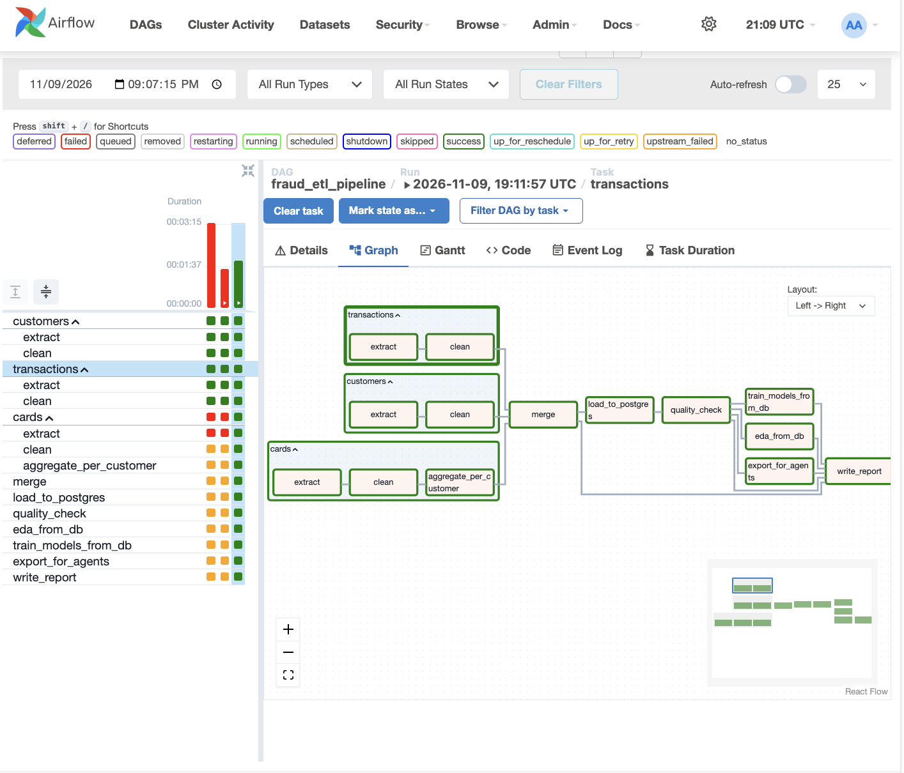
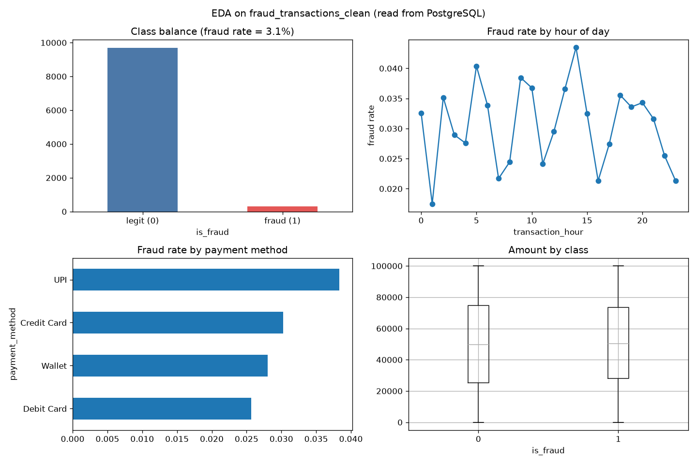
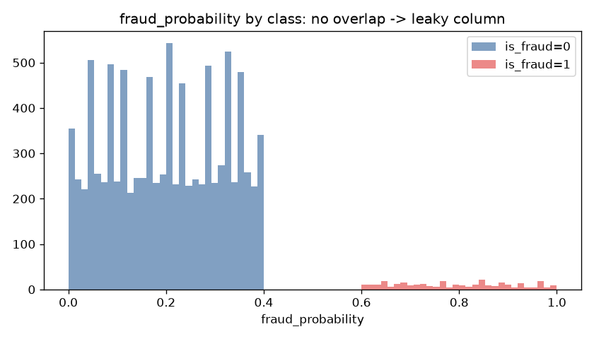
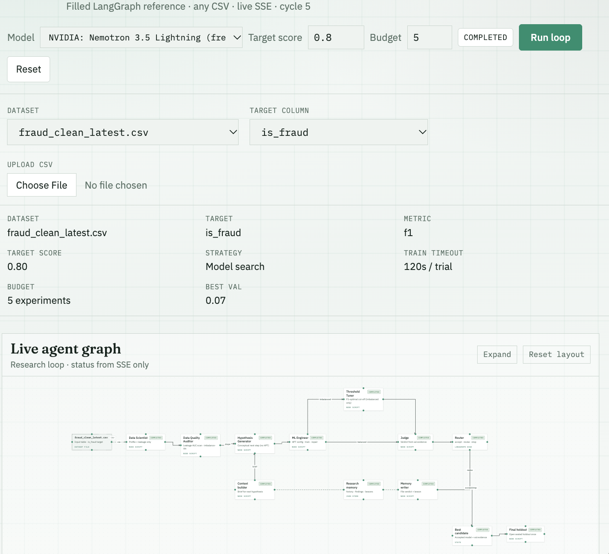
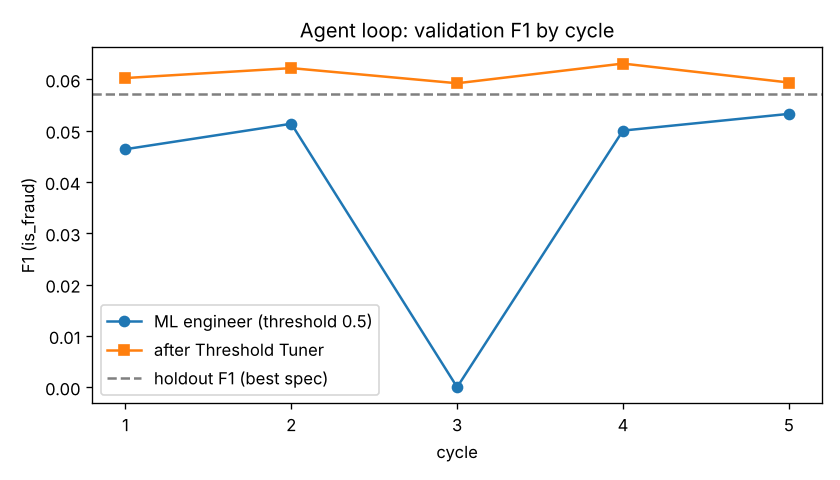
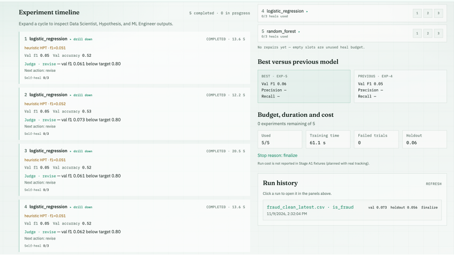

# IDS706 Week 11 — Airflow Pipeline + Agent-Based ML Loop

**Author:** Chen Liu
**Base repo:** fork of the in-class `automl-research-lab` (`refactor/lab-solution-layout`). The original class README is in [`docs/CLASS_README.md`](docs/CLASS_README.md).

| Part | What I built | Main files |
|---|---|---|
| 1 | Scheduled Airflow DAG: 3 related tables → cleaned in parallel TaskGroups → merged → loaded into PostgreSQL → quality gate → EDA + models + export, all read back from the DB | [`lab/airflow/dags/fraud_etl_pipeline.py`](lab/airflow/dags/fraud_etl_pipeline.py) |
| 2 | Modified LangGraph agent loop that trains/evaluates on the Part 1 output, with **2 new agents** and a **new conditional route**; updated live agent graph | [`solution/langgraph/graph.py`](solution/langgraph/graph.py), [`frontend/src/graph/simpleLoopConfig.ts`](frontend/src/graph/simpleLoopConfig.ts), [`scripts/run_part2_loop.py`](scripts/run_part2_loop.py) |
| Setup | Docker Compose stack, Airflow image, dev container | [`infra/docker-compose.yml`](infra/docker-compose.yml), [`infra/Dockerfile.airflow`](infra/Dockerfile.airflow), [`.devcontainer/devcontainer.json`](.devcontainer/devcontainer.json) |

---

## How to run

**Prerequisites:** Docker Desktop (running, ≥ 4 GB memory), Make, Python 3.12+, Node 20+ (for the agent graph UI).
Alternatively, open the repo in VS Code → *Reopen in Container* (uses `.devcontainer/`).

### Part 1 — Airflow pipeline

```bash
cp .env.example .env        # first time only
make airflow                # builds the Airflow image (adds matplotlib) and starts Airflow + Postgres
```

1. Open <http://localhost:8088> (login `admin` / `admin`).
2. Unpause **`fraud_etl_pipeline`**. It runs daily at 00:00 UTC; press ▶ **Trigger DAG** to run it now.
3. Outputs:
   * PostgreSQL table `fraud_transactions_clean` (+ audit table `fraud_pipeline_runs`) in the `airflow-db` container
   * `reports/part1/` — EDA charts, `model_results.md`, `summary.json`
   * `datasets/airflow/fraud_clean_latest.csv` — cleaned export (read from the DB) used by Part 2

Inspect the database:

```bash
docker compose -f infra/docker-compose.yml --env-file .env --profile airflow exec airflow-db \
  psql -U airflow -d airflow -c "SELECT COUNT(*), AVG(is_fraud) FROM fraud_transactions_clean;"
```

### Part 2 — Agent loop

**Live agent graph (UI):**

```bash
make start-mac              # or: make start-windows (Git Bash)
```

Open <http://127.0.0.1:5173/solution-loop> → dataset **`fraud_clean_latest.csv`** → target **`is_fraud`** → Run.
Optional: put an `OPENROUTER_API_KEY` in `.env` so the LLM agents (data scientist, hypothesis, ML engineer, judge) are live; without it they use deterministic heuristics. The two new agents are pure code and always run.

**Command line (saves the evaluation to `reports/part2/`):**

```bash
pip install -r requirements-assignment.txt
python scripts/run_part2_loop.py --max-cycles 5
```

---

## Part 1 — Airflow pipeline

### Data sources

Three related tables from the class fixtures (`datasets/airflow/`, synthetic *Financial Transaction Intelligence Dataset 2026*, Kaggle, CC BY-NC-SA 4.0), joined on `customer_id`:

| Table | Rows | Grain | Role |
|---|---|---|---|
| `transactions.csv` | 10,000 | 1 row / transaction | fact table, label `is_fraud` (3.06% positive) |
| `customers.csv` | 1,000 | 1 row / customer | demographics, income, credit score |
| `cards.csv` | 1,200 | 1 row / card (699 customers have cards) | card limit, utilization, rewards |

### Pipeline structure



```
[customers]    extract → clean ─────────────────────────────┐
[transactions] extract → clean ──────────────────────────────┼→ merge → load_to_postgres → quality_check ─┬→ eda_from_db ──────────┐
[cards]        extract → clean → aggregate_per_customer ─────┘                                            ├→ train_models_from_db ─┼→ write_report
                                                                                                          └→ export_for_agents ────┘
```

### Transformations (each source has its own TaskGroup)

| Step | What it does | Data-quality dimension |
|---|---|---|
| `*.extract` | file exists, required columns present, no empty file, counts duplicate keys | completeness, uniqueness |
| `customers.clean` | dedupe on `customer_id`; coerce numerics, values outside valid ranges (age 18–100, credit score 300–900, non-negative money) → median-imputed and counted; parse dates; drop high-cardinality `city`/`state` | uniqueness, validity |
| `transactions.clean` | dedupe on `transaction_id`; rows with bad timestamp / amount / label go to a **quarantine file** instead of being silently dropped; `Yes/No` → 1/0; drop constant `currency`; add `log_amount`, `amount_vs_30d_avg`, `is_night` | validity, uniqueness |
| `cards.clean` + `aggregate_per_customer` | clip utilization to [0, 1]; then **aggregate to 1 row per customer** (n_cards, total limit, avg/max utilization, rewards, card age) so the join cannot multiply rows | validity, uniqueness |
| `merge` | left joins with `validate="many_to_one"`; customers without cards → zeros + `has_card` flag; `tenure_days` at transaction time; flags 282 transactions dated **before** the customer's signup date; **fails if the row count changes** | consistency |
| `load_to_postgres` | `DROP + CREATE + COPY` in one transaction → reruns are idempotent (no double rows); appends an audit row per run | — |
| `quality_check` | re-reads the DB: rows loaded = rows sent, unique `transaction_id`, binary label, no null amounts; **fails the run otherwise** ("job success ≠ data completeness") | completeness, uniqueness, validity |

### Scheduling and parallel processing

* `schedule="@daily"` — transactions arrive every day, so the table, charts and agent dataset are refreshed once a day at 00:00 UTC. `catchup=False` avoids back-filling every day since `start_date`; `max_active_runs=1` prevents two runs from overwriting the same table at once; `retries=2` handles transient failures.
* **Parallelism:** the three TaskGroups do not depend on each other, so the LocalExecutor runs the three `extract` tasks (and then the cleaning chains) at the same time. After `quality_check`, `eda_from_db`, `train_models_from_db` and `export_for_agents` also run in parallel because each only needs the quality gate. Dependencies are expressed by passing return values (XCom carries only small dicts such as paths and counts; the data itself moves through files and PostgreSQL).

### Analysis results (all read from PostgreSQL)



| Model (stratified 80/20 split) | Uses `fraud_probability` | F1 | ROC-AUC | PR-AUC |
|---|---|---|---|---|
| Logistic regression (scaled, balanced) | no | 0.071 | 0.594 | 0.040 |
| Random forest (balanced) | no | 0.000 | 0.524 | 0.034 |
| Logistic regression | **yes (leak)** | **1.000** | **1.000** | **1.000** |

PR-AUC of a random classifier equals the fraud rate (≈ 0.031). Numbers come from my local run and can differ slightly between machines.



---

## Part 2 — Agent-based ML loop

### What I changed (vs. the in-class `solution/langgraph` loop)



| Change | Type | Why |
|---|---|---|
| **`data_quality_auditor`** (new agent, after `data_scientist`) | added | The data scientist only sees column names and sample rows. The auditor **measures**: single-feature ROC-AUC for every numeric column (≥ 0.95 → leaky), id-like / constant columns, duplicate rows, class imbalance. Its findings are merged into `profile.recommended_drops`, so later agents never train on them. On this data it finds `fraud_probability` (AUC = 1.0) and a 3.06% positive rate. |
| **`threshold_tuner`** (new agent, after `ml_engineer`) | added | With rare positives, the 0.5 cut-off is rarely F1-optimal. It refits the engineer's spec, scans thresholds 0.05–0.95 on the validation split, stores the best one in the spec and updates `best_val_f1`. |
| **Conditional route `ml_engineer → {threshold_tuner \| judge}`** | modified | Adaptive: the tuner only runs when the auditor flagged imbalance and the run succeeded. On the Titanic demo data (38% positive) the loop goes straight to the judge. |
| **Hypothesis stagnation rule** | modified | If the last two cycles used the same model family and F1 moved < 0.01, switch family (the heuristic loop otherwise kept sweeping `C` on logistic regression). |
| **`holdout_eval`** | modified | Applies the tuned threshold and also reports ROC-AUC and PR-AUC (better suited to 3% positives than accuracy). |
| **Live graph** (`simpleLoopConfig.ts`) | modified | Added the two nodes, the `imbalanced` / `balanced` branches and a new layout. |

Loop: `data_scientist → data_quality_auditor → hypothesis_generator → ml_engineer → (threshold_tuner) → judge → revise: memory_writer → context_builder → hypothesis_generator … / accept or budget spent: holdout_eval`.

### Evaluation results — UI run (`/solution-loop`, budget 5, target score 0.8)

| cycle | model | val F1 @0.5 (ML engineer) | val F1 after Threshold Tuner (judged) | judge |
|---|---|---|---|---|
| 1 | logistic_regression | 0.051 | 0.061 | revise |
| 2 | logistic_regression | 0.052 | **0.073** (best) | revise |
| 3 | logistic_regression | 0.051 | 0.061 | revise |
| 4 | logistic_regression | 0.051 | 0.062 | revise |
| 5 | random_forest (stagnation rule → family switch) | 0.056 | 0.060 | revise → budget spent |

**Best validation F1 = 0.073 · sealed holdout F1 = 0.056** · 5/5 experiments, 0 failed trials, 61 s training time, stop reason: finalize.

### Evaluation results — CLI run (`python scripts/run_part2_loop.py --max-cycles 5`, heuristic mode, my machine)

| cycle | model | hyperparameters | val F1 @0.5 | val F1 tuned | threshold |
|---|---|---|---|---|---|
| 1 | logistic_regression | C=0.25 | 0.046 | 0.060 | 0.6 |
| 2 | logistic_regression | C=0.5 | 0.051 | 0.062 | 0.6 |
| 3 | random_forest | 160 trees, depth 8 | 0.000 | 0.059 | 0.1 |
| 4 | logistic_regression | C=2.0 | 0.050 | 0.063 | 0.6 |
| 5 | logistic_regression | C=4.0 | 0.053 | 0.059 | 0.3 |

**Sealed holdout (best spec, 2,000 rows):** F1 = 0.057, ROC-AUC = 0.508, PR-AUC = 0.037 (random baseline 0.030), accuracy = 0.951.




---

## Key findings

1. **The pipeline works and is verifiable:** 10,000 transactions in → 10,000 rows in PostgreSQL (52 columns), all four DB quality checks pass, and reruns do not duplicate data.
2. **Leakage is the biggest risk in this dataset.** `fraud_probability` perfectly separates the classes (every fraud > 0.6, every legit ≤ 0.4). Any model that keeps it reports F1 = 1.0, which is meaningless. The pipeline flags it, and the new auditor agent removes it automatically with measured evidence.
3. **Without the leak there is almost no signal.** The best models reach ROC-AUC ≈ 0.5–0.6 and PR-AUC barely above the 3% base rate. Accuracy (95%) is misleading because predicting "never fraud" already scores 97%, so F1 / PR-AUC are the right metrics.
4. **Threshold tuning helps more than hyperparameter search.** Moving the cut-off raises validation F1 by ~20–40% in every cycle (UI run: 0.052 → 0.073; CLI run: random forest 0.000 → 0.059), while changing `C` or the model family changes almost nothing. The best validation F1 (0.073) drops to 0.056 on the sealed holdout, which is expected because the threshold was chosen on the validation split. The low final score reflects the data, not the pipeline or the agents.
5. **Consistency issue found by the pipeline:** 282 transactions (2.8%) happen before the customer's signup date. They are flagged (`tx_before_signup`) rather than silently dropped.

---

## Screenshots

| File | Shows |
|---|---|
| `screenshots/airflow_dag_runs.png` | successful DAG run (Grid view, all tasks green) |
| `screenshots/airflow_dag_graph.png` | DAG graph view with the 3 TaskGroups |
| `screenshots/airflow_model_metrics.png` | XCom of `train_models_from_db` (model evaluation) |
| `screenshots/agent_graph.png` | live agent graph with the new agents (`/solution-loop`) |
| `screenshots/agent_results.png` | agent loop results (best F1 / holdout metrics) |

## Repository changes at a glance

```
lab/airflow/dags/fraud_etl_pipeline.py   NEW   Part 1 DAG
solution/langgraph/graph.py              MOD   2 new agents, conditional route, stagnation rule, holdout metrics
frontend/src/graph/simpleLoopConfig.ts   MOD   live agent graph (nodes, edges, layout)
scripts/run_part2_loop.py                NEW   CLI run + evaluation report for Part 2
infra/Dockerfile.airflow                 MOD   + matplotlib
.devcontainer/devcontainer.json          NEW   dev container
requirements-assignment.txt              NEW   host / dev-container packages
reports/part1, reports/part2             NEW   generated results
```
